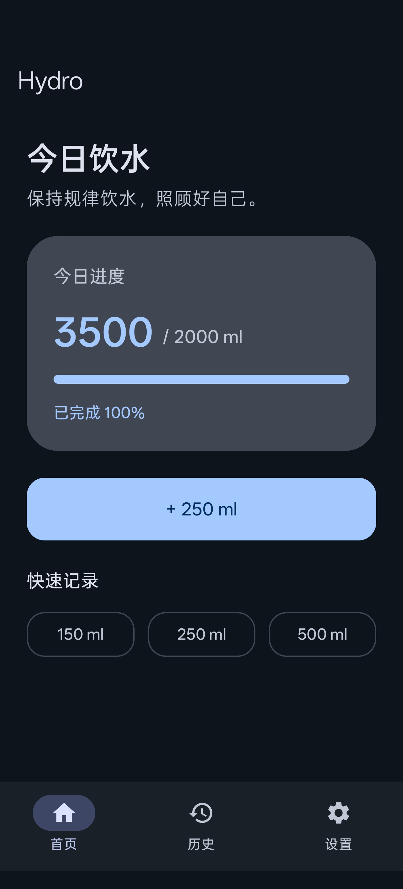
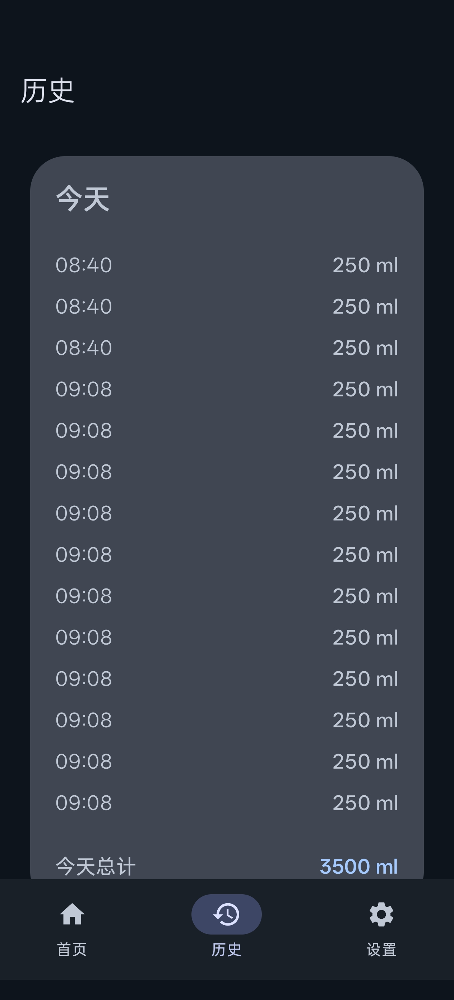
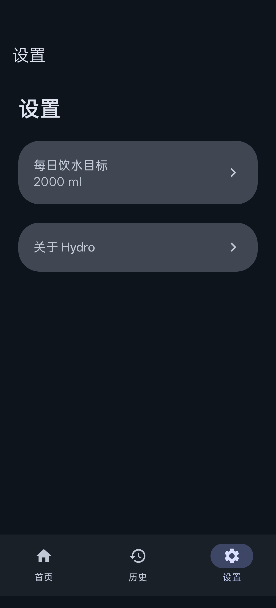

# Hydro 💧

Material Design 3风格的 Android 饮水记录 App。

记录每天喝了多少水，看看自己有没有达到今日目标。

个人尝试Vibe Coding的小项目，算是一个成长学习过程的记录，可能会有意想不到的Bug，功能可能不完善。（整个项目唯一手写的一句话）

## 功能特性

- 快速记录饮水量
- 自定义每日饮水目标
- 每日零点自动重置
- 撤回上一次饮水记录
- 查看历史饮水记录
- 本地持久化保存数据（离线可用）
- 支持深色模式

## 截图

| 首页 | 历史 | 设置 |
| --- | --- | --- |
|  |  |  |

## 技术栈

- Kotlin
- Jetpack Compose
- Material 3
- Room
- DataStore
